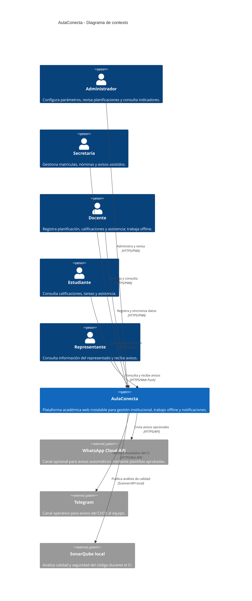
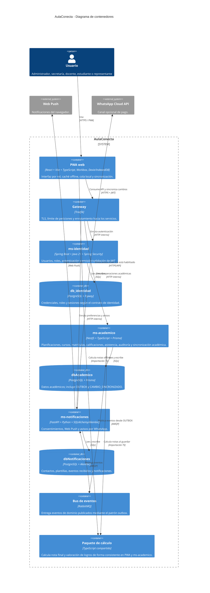
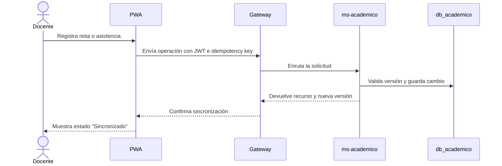
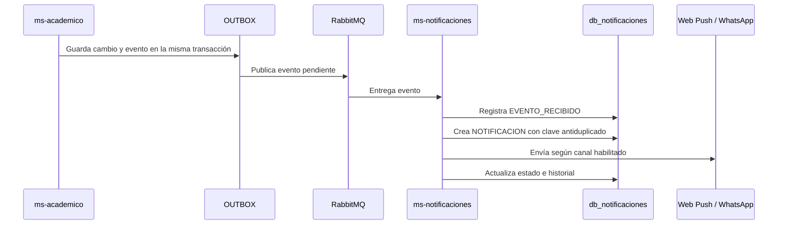

# C4: contexto y contenedores

**Proyecto:** AulaConecta  
**Versión:** arquitectura inicial v2  
**Fecha:** 26/10/2026

## Alcance

AulaConecta permite al personal docente y administrativo gestionar
planificaciones, calificaciones, asistencia y avisos a representantes. La PWA
debe seguir permitiendo registrar notas y asistencia cuando la conectividad es
intermitente; los cambios se sincronizan cuando vuelve la red.

Los diagramas representan la arquitectura acordada en
[seleccion_tecnologias.md](../seleccion_tecnologias.md) y
[modelo_datos.md](../modelo_datos.md): tres microservicios, una base por
servicio, Gateway, RabbitMQ y el paquete compartido de cálculo.

## Nivel 1: contexto del sistema

### Límites del sistema

- Los usuarios interactúan con AulaConecta mediante la PWA; no conocen las
  bases de datos ni la mensajería interna.
- WhatsApp Cloud API es opcional: el nivel gratuito principal es Web Push y
  el canal asistido abre un mensaje preparado para que lo envíe una persona.
- Telegram y SonarQube pertenecen a la operación del proyecto, no al dominio
  académico ni al almacenamiento de datos de estudiantes.
- Los datos reales de estudiantes no se incluyen en el repositorio ni en
  Telegram.

## Nivel 2: contenedores

## Reglas de comunicación y propiedad de datos

1. La PWA solo consume el Gateway; nunca conecta directamente con PostgreSQL o
   RabbitMQ.
2. Cada microservicio es dueño de su base. Las referencias entre servicios son
   UUID, no claves foráneas cruzadas.
3. `ms-academico` publica eventos en su `OUTBOX` dentro de la misma transacción
   que el cambio académico. Un publicador posterior los entrega a RabbitMQ.
4. `ms-notificaciones` registra `EVENTO_RECIBIDO` antes de procesarlo para
   evitar duplicados.
5. El JWT identifica al usuario y sus roles; la autorización se aplica en el
   servicio dueño del recurso, no solo en la PWA.
6. El paquete de cálculo no es un servicio ni una base de datos: es una
   dependencia compartida versionada con el monorepo.

## Flujos principales

### Registro académico online

### Evento de bajo rendimiento o falta

## Decisiones pendientes de implementación

- Definir contratos exactos de sincronización (`GET /sync/pull` y
  `POST /sync/push`) junto con los contratos OpenAPI de cada servicio.
- Registrar el dispositivo y la versión de esquema de la PWA para controlar
  migraciones de IndexedDB.
- Definir límites de tamaño y retención para la cola local.
- Implementar el publicador de `OUTBOX` y reintentos con backoff.
