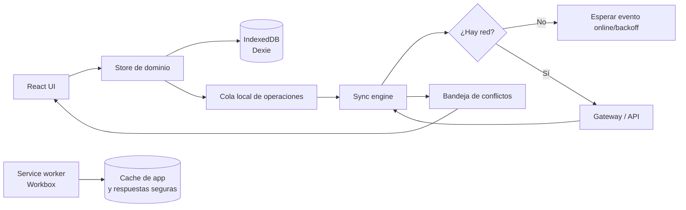
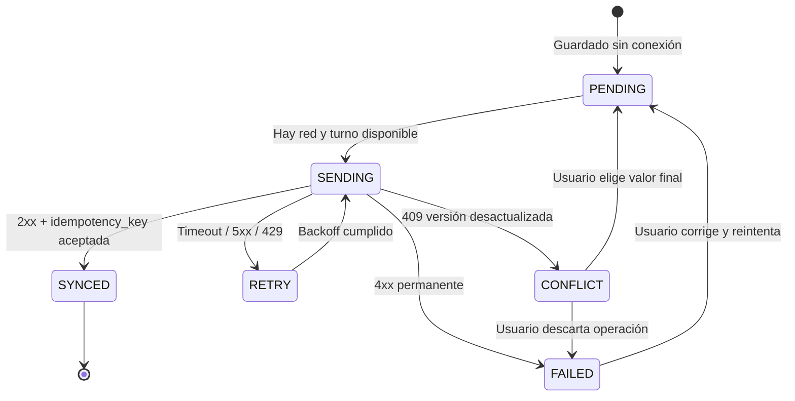

# Diseño del trabajo sin conexión

**Objetivo:** permitir que un docente consulte datos previamente descargados y
registre notas y asistencia sin Internet, sin perder cambios ni sobrescribir
silenciosamente los cambios de otra persona.

## Alcance inicial offline

| Capacidad | Offline | Motivo |
|---|---:|---|
| Consultar cursos, materias y matrículas sincronizadas | Sí | La PWA necesita el contexto para registrar |
| Registrar asistencia | Sí | Es una operación frecuente en aulas con conectividad irregular |
| Registrar o editar calificaciones | Sí | Se requiere continuidad durante la clase |
| Consultar planificación previamente cargada | Sí | Evita bloquear la revisión o preparación |
| Editar planificación | Sí, con resolución de conflictos | Puede involucrar revisión de otra persona |
| Crear usuarios, cambiar roles o revocar acceso | No | Requiere autorización y estado actual del servidor |
| Enviar WhatsApp o cambiar consentimiento | No | Es una operación sensible y dependiente del servidor |
| Consultar información nunca sincronizada | No | La PWA no debe inventar ni mostrar datos incompletos |

La interfaz debe mostrar siempre el estado de conectividad y la cantidad de
cambios pendientes. "Guardado localmente" no equivale a "guardado en el
servidor".

## Componentes locales



### Responsabilidades

- **Workbox/service worker:** entrega el shell de la PWA y recursos estáticos
  cacheables. No debe cachear respuestas sensibles indefinidamente.
- **IndexedDB/Dexie:** guarda el último estado sincronizado, operaciones
  pendientes, conflictos y metadatos de sincronización.
- **Store de dominio:** actualiza la pantalla de forma optimista, pero etiqueta
  el registro como pendiente hasta recibir confirmación del servidor.
- **Sync engine:** procesa la cola en orden, reintenta errores transitorios y
  detiene solo la operación que requiere intervención.
- **Bandeja de conflictos:** presenta valores local/servidor y permite elegir o
  editar el valor final.

## Modelo de la cola local

Cada modificación local genera una operación independiente. No se guarda solo
el estado final de la pantalla, porque se perdería el orden y la posibilidad de
reintentar o auditar.

```text
sync_queue
-----------
operation_id       UUID, clave única de la operación
entity             nombre lógico: asistencia, calificacion, planificacion...
entity_id          UUID del registro afectado
operation          CREATE | UPDATE | DELETE_LOGICAL
base_version       versión observada antes de editar
payload            JSON validado de los campos modificados
changed_fields     lista de campos modificados
device_id          UUID estable de la instalación
user_id            UUID del usuario autenticado
idempotency_key    UUID único, enviado al servidor
status             PENDING | SENDING | RETRY | CONFLICT | SYNCED | FAILED
attempts           cantidad de intentos
next_attempt_at    fecha del próximo reintento
last_error         código técnico no sensible
created_at         fecha local de creación
updated_at         fecha local de actualización
```

El estado local del recurso conserva además:

```text
entity_cache
------------
entity_id
server_version
server_updated_at
server_updated_by
data
sync_state         SYNCED | DIRTY | CONFLICT
```

El `payload` solo debe contener los campos permitidos por el contrato de la
API. Nunca se almacenan tokens, contraseñas ni datos de autenticación en la
cola.

## Estados y ciclo de sincronización



### Reglas de reintento

- `408`, `429`, errores de red y `5xx`: reintento automático con backoff
  exponencial y un máximo de 5 intentos.
- `401`: pausar la cola y solicitar autenticación; no reintentar en bucle.
- `403`, `404`, `422`: marcar `FAILED` y mostrar una explicación accionable.
- `409`: marcar `CONFLICT`; nunca sobrescribir automáticamente el servidor.
- Una operación con `SYNCED` no se vuelve a enviar aunque el usuario recargue
  la página.

## Protocolo de sincronización

### 1. Preparar

Al iniciar sesión y cada vez que vuelve la red, la PWA solicita cambios del
servidor desde el cursor guardado:

```text
GET /sync/pull?cursor=<cursor>&limit=100
```

La respuesta incluye recursos cambiados, eliminaciones lógicas, nuevo cursor y
la versión de esquema. La PWA aplica los cambios que no tengan modificaciones
locales pendientes.

### 2. Enviar

La PWA toma la operación `PENDING` más antigua de cada entidad y envía un lote
pequeño:

```text
POST /sync/push
Authorization: Bearer <JWT>
Idempotency-Key: <operation_id>
Content-Type: application/json
```

```json
{
  "operations": [
    {
      "operationId": "uuid",
      "entity": "asistencia",
      "entityId": "uuid",
      "operation": "UPDATE",
      "baseVersion": 3,
      "changedFields": ["estado", "justificacion"],
      "payload": {
        "estado": "JUSTIFICADA",
        "justificacion": "Cita médica"
      }
    }
  ]
}
```

El servidor responde por operación, no solo por lote:

```json
{
  "results": [
    {
      "operationId": "uuid",
      "status": "SYNCED",
      "entityId": "uuid",
      "serverVersion": 4
    }
  ],
  "nextCursor": "cursor"
}
```

Una misma `operationId` recibida dos veces devuelve el resultado original y no
aplica el cambio nuevamente. Esta garantía se implementa en
`CAMBIO_SINCRONIZADO`/la tabla de idempotencia del servicio dueño.

### 3. Actualizar

Después de enviar, la PWA aplica la respuesta, actualiza `server_version`,
elimina la operación `SYNCED` y avanza el cursor. El cursor solo avanza
después de persistir los cambios recibidos; así una interrupción no genera
pérdida silenciosa.

## Resolución de conflictos

El servidor compara `baseVersion` con la versión actual del registro. Si no
coinciden, responde `409 Conflict` con el estado del servidor y los metadatos
necesarios:

```json
{
  "status": "CONFLICT",
  "entityId": "uuid",
  "baseVersion": 3,
  "serverVersion": 4,
  "serverData": {},
  "serverUpdatedBy": "uuid",
  "serverUpdatedAt": "2026-10-26T20:00:00Z",
  "conflictingFields": ["estado"]
}
```

### Política por tipo de dato

| Dato | Política | Razón |
|---|---|---|
| Nuevo registro con UUID propio | Aceptar si pasa validación | Dos dispositivos pueden crear registros sin colisión |
| Asistencia del mismo estudiante y fecha | Conflicto manual | Una corrección no debe ocultar la decisión de otro docente |
| Calificación o nota final | Conflicto manual | Impacta reportes y comunicación a representantes |
| Justificación de asistencia | Conflicto manual por campo | Puede requerir evidencia o revisión |
| Campos independientes de una planificación | Merge por campo si no se solapan | Permite colaboración sin perder cambios distintos |
| Estado de revisión/aprobación | Servidor gana y requiere revisión manual | Es una transición con autoridad y auditoría |
| Parámetros, roles y consentimientos | No disponible offline | Requiere autorización y estado actual |
| Borrado lógico | Conflicto manual | El historial académico no se elimina silenciosamente |

No se usa "último escritor gana" para notas, asistencia, aprobaciones o
consentimiento. Esa estrategia ocultaría errores y sería difícil de auditar.

## Interfaz de resolución

Cuando una operación entra en `CONFLICT`, la PWA debe:

1. Mantener el valor local y el del servidor.
2. Mostrar quién y cuándo modificó el valor del servidor.
3. Resaltar únicamente los campos en conflicto.
4. Permitir conservar servidor, conservar local o editar una combinación.
5. Registrar la decisión y crear una nueva operación con la versión actual del
   servidor.
6. No borrar la operación original; conservarla como evidencia.

El usuario no debe poder cerrar el conflicto como si estuviera sincronizado.
El estado visible debe ser `Conflicto pendiente`.

## Seguridad y privacidad offline

- Proteger el acceso a la PWA con sesión expirable y bloqueo local del
  dispositivo.
- No guardar contraseñas ni tokens de larga duración en IndexedDB.
- Cifrar datos locales cuando la capacidad de la plataforma lo permita y
  minimizar el conjunto cacheado.
- Borrar datos locales al cerrar sesión o al cambiar de usuario/dispositivo,
  según la política de seguridad definida.
- Aplicar autorización nuevamente en el servidor al sincronizar; la PWA no es
  una frontera de seguridad.
- No enviar datos de estudiantes en logs, mensajes de Telegram ni errores
  visibles del cliente.

## Criterios de aceptación

1. Un docente puede abrir cursos previamente sincronizados sin Internet.
2. Puede registrar asistencia y calificaciones, cerrar la PWA y conservar los
   cambios en IndexedDB.
3. Al volver la red, las operaciones se envían sin duplicarse.
4. Un timeout no pierde la operación y la reintenta con backoff.
5. Un `409` se muestra como conflicto y no sobrescribe el servidor.
6. Dos cambios sobre campos distintos de una planificación pueden combinarse
   sin perder datos.
7. El usuario puede resolver manualmente un conflicto de nota, asistencia o
   aprobación.
8. Una operación repetida con la misma idempotency key produce un único cambio
   en el servidor.
9. Cerrar sesión no deja datos académicos del usuario anterior disponibles
   para el siguiente usuario.
