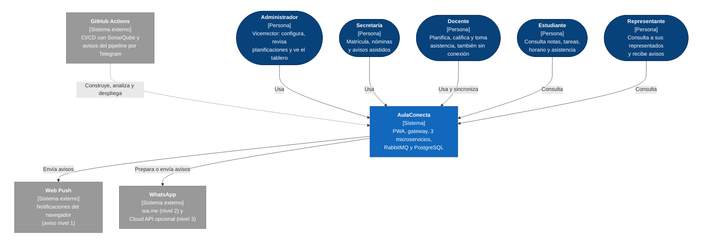
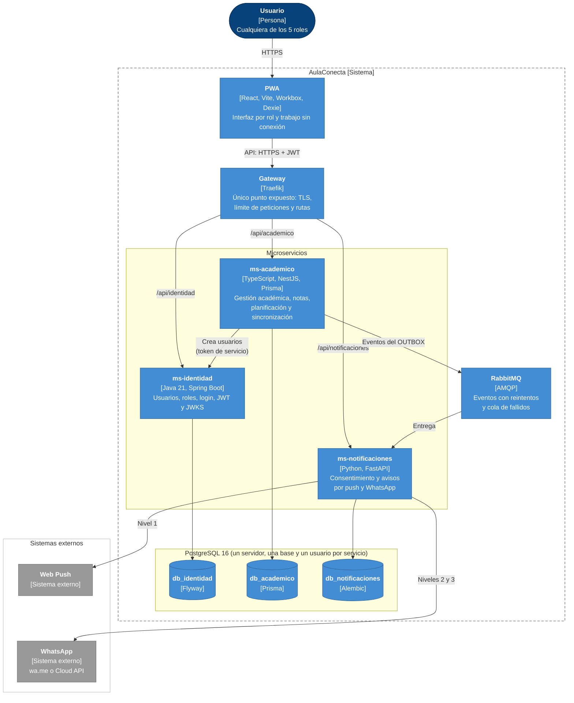
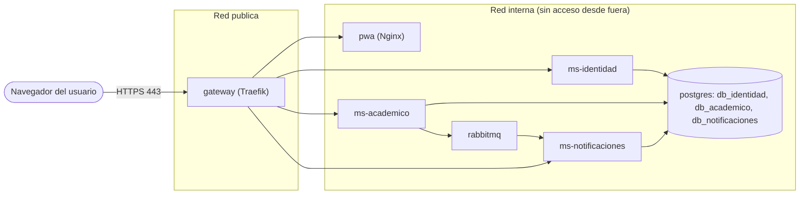
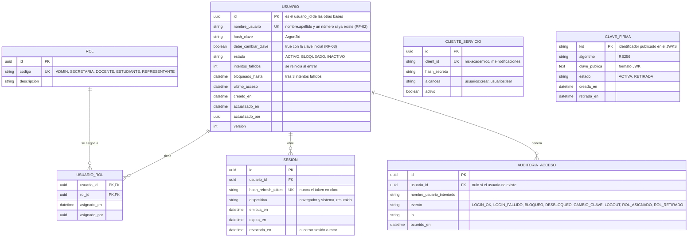
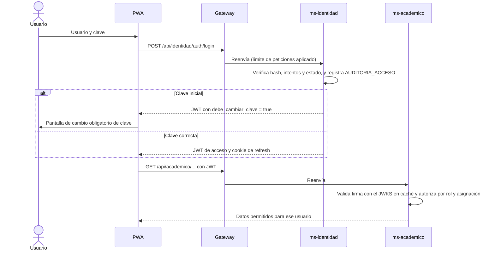

# Arquitectura C4 v2

**Tarea:** T1026-A · **Responsable:** Abner David Arboleda Roman · **Fecha:** 26/10/2026 · **Sprint 3**

Vista consolidada de la arquitectura v2: **gateway, 3 microservicios, RabbitMQ y PostgreSQL**, más el modelo de datos de ms-identidad. Complementa:

- [Diagramas/c4_contexto_contenedores.md](Diagramas/c4_contexto_contenedores.md): C4 inicial con los flujos de registro académico y de avisos.
- [Diagramas/trabajo_sin_conexion.md](Diagramas/trabajo_sin_conexion.md): cola local, sincronización y conflictos.
- [modelo_datos.md](modelo_datos.md): modelo de datos de ms-academico y ms-notificaciones.
- [../seguridad/modelo_amenazas.md](../seguridad/modelo_amenazas.md): amenazas STRIDE sobre esta arquitectura.

**Qué agrega respecto al C4 inicial:**
- PostgreSQL como un solo servidor con una base y un usuario por servicio.
- Las rutas del gateway y la validación del JWT con JWKS.
- Las colas de RabbitMQ con la cola de mensajes fallidos.
- La vista de despliegue con redes separadas.
- El modelo de datos de ms-identidad.

Los nombres de rutas, puertos y colas son **propuestos**: se confirman al crear los esqueletos (27/10) y los contratos OpenAPI.

## 1. Nivel 1: contexto

El rol Representante se suma a los cuatro roles de RF-01 porque RF-38 le da su propia vista. GitHub Actions, SonarQube y Telegram son parte de la operación del proyecto y nunca reciben datos de estudiantes.

## 2. Nivel 2: contenedores

Notación C4: azul oscuro = persona, azul = contenedor de AulaConecta, gris = sistema externo; entre corchetes, la tecnología.

### Contenedores

| Contenedor | Tecnología | Puerto interno (propuesto) | Responsabilidad | Responsable del esqueleto |
|---|---|---|---|---|
| PWA | React + Vite + TypeScript, servida por Nginx | 80 | Interfaz por rol; IndexedDB y cola local para trabajar sin conexión | Christian |
| Gateway | Traefik | 443 (único expuesto) y 80 → 443 | TLS, cabeceras de seguridad, límite de peticiones por IP (por usuario desde T1105-A), enrutamiento por prefijo | Abner |
| ms-identidad | Spring Boot 4 · Java 21 | 8080 | Inicio de sesión, JWT RS256, JWKS, usuarios, roles, bloqueo de cuenta y auditoría de accesos | Abner |
| ms-academico | NestJS · TypeScript | 3000 | Año lectivo, cursos, matrícula, notas, asistencia, comportamiento, planificación, reportes y sincronización | Marcelo |
| ms-notificaciones | FastAPI · Python | 8000 | Contactos, consentimiento, plantillas, push y WhatsApp, historial de avisos | Christian (esqueleto) y Marcelo (módulo) |
| RabbitMQ | RabbitMQ 3 | 5672 (panel 15672 solo en local) | Entrega de eventos con reintentos y cola de mensajes fallidos | Christian |
| PostgreSQL | PostgreSQL 16 | 5432 | Un servidor con tres bases separadas (sección 3) | Abner |

### Reglas de comunicación

| Origen → destino | Protocolo | Autenticación | Regla |
|---|---|---|---|
| PWA → gateway | HTTPS | JWT de acceso en la cabecera `Authorization` | La PWA nunca llama a un servicio ni a una base directamente |
| Gateway → servicios | HTTP en la red interna | Reenvía el JWT | El gateway no decide permisos: cada servicio valida el JWT y autoriza |
| Servicios → ms-identidad (JWKS) | HTTP interno | Público dentro de la red | Cada servicio guarda en caché las claves públicas y valida la firma localmente |
| ms-academico → ms-identidad (crear usuario) | HTTP interno | Token de servicio (client credentials) | Solo ms-academico puede crear usuarios de docentes, estudiantes y representantes |
| ms-academico → RabbitMQ → ms-notificaciones | AMQP | Usuario de RabbitMQ por servicio | Eventos publicados desde el OUTBOX; ms-notificaciones registra cada evento antes de procesarlo |
| Servicio → su base | SQL | Usuario de PostgreSQL propio | Un servicio no puede conectarse a la base de otro |

Eventos y colas propuestos:

| Elemento | Nombre | Uso |
|---|---|---|
| Exchange | `aulaconecta.eventos` (tipo topic) | Recibe todos los eventos de dominio |
| Claves de enrutamiento | `academico.promedio_bajo`, `academico.falta_registrada` | Los dos eventos que generan avisos externos (CR-01) |
| Cola | `notificaciones.avisos` | Consumida por ms-notificaciones |
| Cola de fallidos | `notificaciones.avisos.dlq` | Mensajes que fallaron después de los reintentos, para revisarlos sin bloquear la cola |

## 3. PostgreSQL: un servidor, tres bases

En el ambiente de pruebas y en el despliegue inicial se usa **un solo servidor PostgreSQL**, para ahorrar recursos, con una base y un usuario por servicio. Los permisos impiden que un servicio lea los datos de otro aunque compartan el servidor.

| Base | Usuario | Permisos | Migraciones |
|---|---|---|---|
| `db_identidad` | `usr_identidad` | Dueño solo de `db_identidad` | Flyway (`db/migration/V1__init.sql`) |
| `db_academico` | `usr_academico` | Dueño solo de `db_academico` | Prisma Migrate |
| `db_notificaciones` | `usr_notificaciones` | Dueño solo de `db_notificaciones` | Alembic |

El script `infra/postgres/init.sql` (T1028-A) crea las bases y los usuarios, y revoca el permiso `CONNECT` de `PUBLIC` en cada base. Las contraseñas llegan por variables de entorno desde GitHub Secrets y nunca se escriben en el repositorio.

## 4. Despliegue con Docker Compose

| Decisión | Motivo |
|---|---|
| Solo el gateway publica un puerto | Reduce la superficie de ataque; las bases, RabbitMQ y los servicios no son accesibles desde fuera (límite LC2 del modelo de amenazas) |
| Imágenes construidas, escaneadas con Trivy y publicadas en GHCR por el CI | Lo que se despliega es lo que se analizó (T1104-A) |
| Secretos por variables de entorno desde GitHub Environments | Ningún secreto en el repositorio ni en las imágenes (T1116-A) |
| Los servicios corren con usuario sin privilegios dentro del contenedor | Limita el daño si un servicio es comprometido |

## 5. Modelo de datos de ms-identidad (`db_identidad`)

ms-identidad guarda **solo lo necesario para autenticar y autorizar**. Los datos personales (nombres, cédula, curso) viven en `PERSONA` de ms-academico, ligada por `usuario_id`. La cédula llega una sola vez, al crear el usuario, para fijar la clave inicial (RF-03), y se guarda únicamente su hash.

| Tabla | Para qué | Requisito |
|---|---|---|
| `USUARIO` | Credenciales, estado de la cuenta y bloqueo | RF-02, RF-03, RNF-04 |
| `ROL`, `USUARIO_ROL` | Roles del usuario; una persona puede tener más de uno (por ejemplo, docente que también es representante) | RF-01 |
| `SESION` | Refresh tokens guardados como hash, para revocarlos y rotarlos | RNF-04 |
| `AUDITORIA_ACCESO` | Registro de entradas, fallos, bloqueos y cambios de rol; solo se insertan filas, nunca se editan | RNF-09, RNF-12 |
| `CLIENTE_SERVICIO` | Credenciales de los otros microservicios para el token de servicio | Modelo de amenazas S-03 |
| `CLAVE_FIRMA` | Claves públicas publicadas en el JWKS; permite rotar la clave sin cortar las sesiones | Modelo de amenazas S-02 |

La **clave privada** de firma no se guarda en la base: llega al contenedor como secreto. Las tablas siguen las reglas comunes de [modelo_datos.md](modelo_datos.md#1-reglas-comunes-a-todas-las-tablas) (UUID, `version`, borrado lógico con `estado`).

### Tokens

| Token | Duración (propuesta) | Dónde se guarda | Contenido |
|---|---|---|---|
| Acceso (JWT RS256) | 15 minutos | En memoria de la PWA | `sub` (usuario_id), `roles`, `debe_cambiar_clave`, `iss`, `aud`, `exp`, `kid` |
| Refresh | 8 horas (una jornada), se rota en cada uso | Cookie `HttpOnly`, `Secure`, `SameSite=Strict` | Valor aleatorio; en la base solo su hash |
| Servicio | 5 minutos | Memoria del servicio que lo pide | `sub` (client_id), `alcances` |

Sin conexión, la PWA no necesita a ms-identidad: registra en la cola local. Al volver la red, renueva el token de acceso; si el refresh venció, pausa la cola y pide iniciar sesión, sin perder los cambios pendientes (ver [trabajo_sin_conexion.md](Diagramas/trabajo_sin_conexion.md)).

### Inicio de sesión y validación del token

### Creación de usuarios

Cuando el administrador registra un docente o la secretaría matricula a un estudiante, **ms-academico** pide la cuenta a ms-identidad con su token de servicio:

1. ms-academico envía `nombres`, `apellidos`, `rol` y la cédula (solo para la clave inicial) a `POST /usuarios`.
2. ms-identidad genera `nombre_usuario` (RF-02), guarda el hash de la clave inicial con `debe_cambiar_clave = true` y devuelve el `usuario_id`.
3. ms-academico guarda ese `usuario_id` en `PERSONA`. La cédula no queda en `db_identidad`.

## 6. Relación con el modelo de amenazas

| Límite de confianza | Dónde aparece en esta arquitectura | Controles principales |
|---|---|---|
| LC1: dispositivo ↔ gateway | PWA → Traefik | TLS, límite de peticiones, JWT de corta duración |
| LC2: gateway ↔ servicios | Red interna de Docker | Solo el gateway expuesto, validación del JWT en cada servicio, token de servicio entre servicios |
| LC3: ms-notificaciones ↔ terceros | Web Push y WhatsApp | Solo números autorizados, plantillas sin detalle de notas |
| LC4: repositorio ↔ CI/CD | GitHub Actions, SonarQube, Telegram | Gitleaks, análisis de dependencias, imágenes escaneadas, secretos en GitHub |
