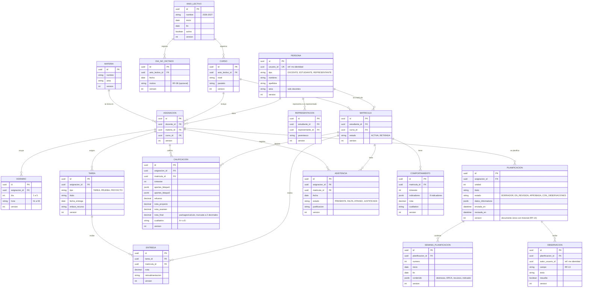
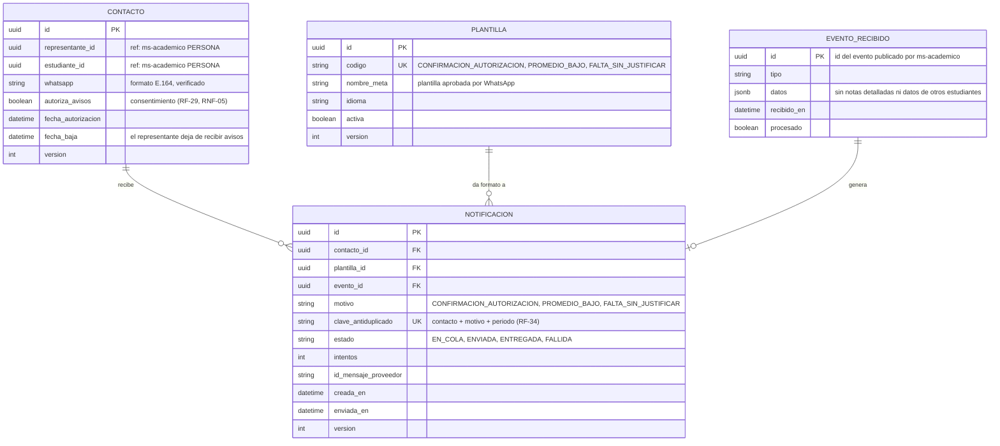
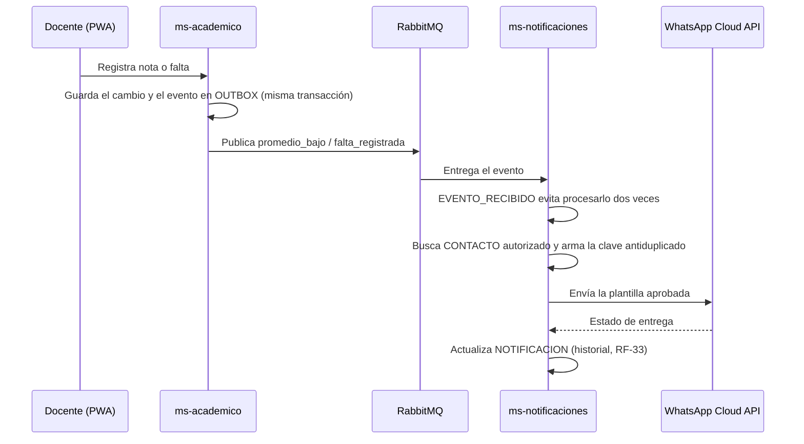

# Modelo de datos por servicio v2

**Tarea:** T1026-M · **Responsable:** Christian Marcelo Acuña Gamboa · **Fecha:** 26/10/2026 · **Sprint 3**
**Cambia respecto a la v1 (23/10):** la arquitectura pasó de un solo backend a **3 microservicios** (planificación v2). Cada servicio tiene su propia base de datos y no lee las tablas de los otros.

| Servicio | Tecnología | Base de datos | Modelo de datos |
|---|---|---|---|
| ms-identidad | Spring Boot (Java 21) | `db_identidad` (Flyway) | Abner (T1026-A) |
| **ms-academico** | NestJS (TypeScript) | `db_academico` (Prisma) | Este documento |
| **ms-notificaciones** | FastAPI (Python) | `db_notificaciones` (SQLAlchemy + Alembic) | Este documento |

## 1. Reglas comunes a todas las tablas

| Regla | Para qué | Requisito |
|---|---|---|
| **`id` UUID** generado por quien crea el registro (incluida la PWA sin conexión) | Dos docentes sin internet pueden crear registros a la vez sin chocar en el número de ID; al sincronizar, el ID ya es único | RNF-01 |
| **`version` entero**, que sube en 1 con cada cambio | Base de la sincronización: si llega un cambio hecho sobre una versión vieja, hay conflicto y se resuelve con la regla por campo | RNF-01 |
| `creado_en`, `actualizado_en`, `actualizado_por` | Saber quién cambió qué y cuándo | RNF-09 |
| Referencias a otro servicio solo por UUID, **sin llave foránea** | Cada servicio es dueño de sus datos; las personas se identifican con el `usuario_id` del token emitido por ms-identidad | Arquitectura v2 |
| Borrado lógico (`activo` o `estado`) en lugar de borrar filas | Conservar el historial académico | RNF-09 |

En los diagramas, `ref` marca un UUID que apunta a otro servicio.

## 2. ms-academico (`db_academico`)

Tablas de soporte de ms-academico (sin relaciones en el diagrama para no saturarlo):

| Tabla | Para qué | Requisito |
|---|---|---|
| `PARAMETRO` | Ponderaciones, escalas y textos de comportamiento editables por el administrador | RNF-10 |
| `AUDITORIA` | Quién cambió qué, con valor anterior y nuevo | RNF-09 |
| `OUTBOX` | Eventos pendientes de publicar en RabbitMQ (`promedio_bajo`, `falta_registrada`). Se escriben en la **misma transacción** que el cambio, así no se pierde ningún aviso aunque RabbitMQ esté caído | RF-30, RF-31, RF-35 |
| `CAMBIO_SINCRONIZADO` | Registro de cada cambio recibido desde la PWA, con su clave de idempotencia: el mismo cambio enviado dos veces se guarda una sola vez | RNF-01 |

## 3. ms-notificaciones (`db_notificaciones`)

## 4. Cómo viaja un aviso entre los dos servicios

## 5. Decisiones

| Decisión | Motivo |
|---|---|
| Docentes, estudiantes y representantes se modelan como `PERSONA` en ms-academico, ligada al `usuario_id` de ms-identidad | ms-identidad solo guarda credenciales y roles; los datos académicos no salen de ms-academico |
| El número de WhatsApp y el consentimiento viven en ms-notificaciones | Solo el servicio que envía mensajes ve los teléfonos (principio de mínimo privilegio, RNF-04) |
| Patrón *outbox* + tabla de eventos recibidos | Garantiza que cada aviso se envíe una sola vez aunque fallen la red o RabbitMQ (RF-34, RF-35) |
| `CALIFICACION` guarda la nota final ya calculada | Se calcula con `packages/calculo` al guardar; los reportes no recalculan (RNF-02) |
| Calificaciones, asistencia y comportamiento cuelgan de `MATRICULA` | Conservan el historial si el estudiante cambia de curso o se retira (RF-24) |

## 6. En qué sprint se crea cada tabla

| Sprint | ms-academico | ms-notificaciones |
|---|---|---|
| 3 (28/10) | ANIO_LECTIVO, CURSO, MATERIA, MATRICULA (migración inicial) | Base vacía con Alembic |
| 4 | PERSONA, REPRESENTACION, ASIGNACION, HORARIO, DIA_NO_DICTADO, AUDITORIA | — |
| 5 | CALIFICACION, TAREA, ENTREGA, ASISTENCIA, COMPORTAMIENTO, PARAMETRO, OUTBOX | — |
| 7 | PLANIFICACION, SEMANA_PLANIFICACION, OBSERVACION | — |
| 8 | — | CONTACTO, PLANTILLA, EVENTO_RECIBIDO, NOTIFICACION |
| 9 | CAMBIO_SINCRONIZADO | — |
