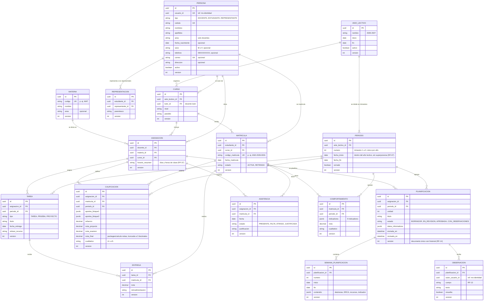
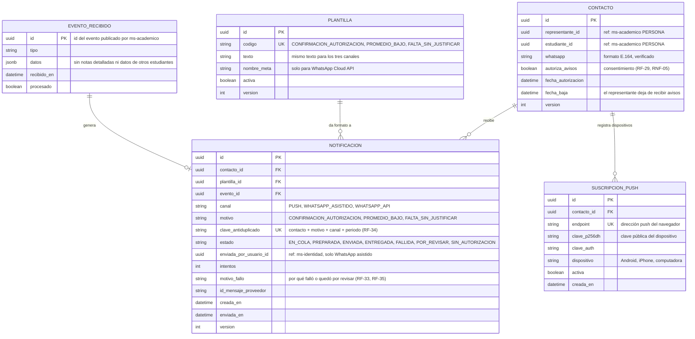
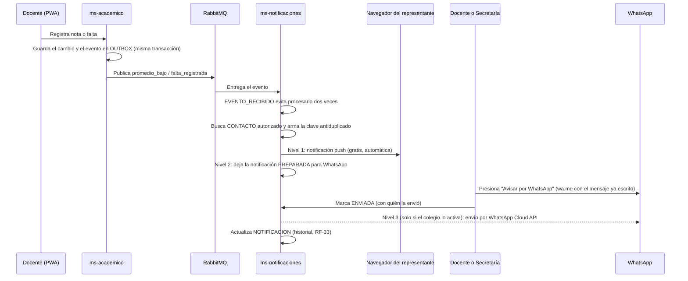

# Modelo de datos por servicio v3

**Tarea:** T1026-M (v2) · T1113-A (v3) · **Fecha:** 16/11/2026 · **Sprint 5**
**Cambia respecto a la v2 (26/10):** se alinea con el modelo entidad–relación y el diccionario de datos del Taller 2 ([docs/modelos/bd](../modelos/bd), `docs/analisis/Grupo01_Taller2_2.pdf`): tabla `PERIODO` (trimestres), código de materia, código y fecha de matrícula, datos personales opcionales, estados del aviso del diagrama de estados y `motivo_fallo`. Se quitan `DIA_NO_DICTADO` (RF-08 queda fuera de la versión 1.0) y `HORARIO` (el horario es el texto `horario_resumen` de la asignación, RF-37).
**Desde la v2:** la arquitectura tiene **3 microservicios**. Cada servicio tiene su propia base de datos y no lee las tablas de los otros.

| Servicio | Tecnología | Base de datos | Modelo de datos |
|---|---|---|---|
| ms-identidad | Spring Boot (Java 21) | `db_identidad` (Flyway) | [c4.md, sección 5](c4.md#5-modelo-de-datos-de-ms-identidad-db_identidad) (T1026-A) |
| **ms-academico** | NestJS (TypeScript) | `db_academico` (Prisma) | Este documento |
| **ms-notificaciones** | FastAPI (Python) | `db_notificaciones` (SQLAlchemy + Alembic) | Este documento |

## 0. Modelo lógico y su reparto en las tres bases

El **modelo lógico de referencia** es el del Taller 2: 27 tablas en un solo esquema MySQL 5.0 para PowerDesigner ([aulaconecta_mysql50.sql](../modelos/bd/aulaconecta_mysql50.sql)), con las reglas obligatorias de la guía (persona 1 a 1 usuario, rol N a N usuario, claves `id_<tabla>` hexadecimales). La implementación lo reparte en tres bases PostgreSQL; las relaciones que cruzan de una base a otra se guardan como UUID **sin llave foránea**.

| Tabla lógica (Taller 2) | Base física | Tabla física | Nota |
|---|---|---|---|
| `persona` | `db_academico` | `persona` | El celular para avisos y su autorización están además en `contacto` de `db_notificaciones` |
| `usuario` | `db_identidad` | `usuario` | `usuario.id_persona` del modelo lógico se guarda al revés: `persona.usuario_id` (único) en `db_academico`, así ms-identidad no conoce datos personales. El estado PENDIENTE es `debe_cambiar_clave = true` |
| `rol`, `usuario_rol` | `db_identidad` | `rol`, `usuario_rol` | El código técnico de Administrador es `ADMIN` |
| `anio_lectivo`, `periodo`, `curso`, `materia`, `matricula` | `db_academico` | mismas | Ya implementadas (Prisma) |
| `asignacion`, `representacion`, `planificacion`, `semana_planificacion`, `observacion`, `tarea`, `entrega`, `calificacion`, `asistencia`, `comportamiento`, `parametro` | `db_academico` | mismas | Se crean en los sprints 5 a 7 (sección 6) |
| `plantilla`, `notificacion`, `suscripcion_push` | `db_notificaciones` | mismas | Más `contacto` y `evento_recibido`, propias de la implementación (sección 3) |
| `comunicado` | `db_notificaciones` | — | RF-32; se crea con los avisos (sprint 8) |
| `auditoria` | `db_academico` y `db_identidad` | `auditoria` y `auditoria_acceso` | Cada servicio audita sus propios cambios (RNF-09) |
| `outbox`, `cambio_sincronizado` | `db_academico` | mismas | Eventos de avisos y sincronización sin conexión |

ms-identidad tiene además `sesion`, `cliente_servicio` y `clave_firma`, que son técnicas (tokens y firma) y no forman parte del modelo lógico.

## 1. Reglas comunes a todas las tablas

| Regla | Para qué | Requisito |
|---|---|---|
| **`id` UUID** generado por quien crea el registro (incluida la PWA sin conexión) | Dos docentes sin internet pueden crear registros a la vez sin chocar en el número de ID; al sincronizar, el ID ya es único | RNF-01 |
| **`version` entero**, que sube en 1 con cada cambio | Base de la sincronización: si llega un cambio hecho sobre una versión vieja, hay conflicto y se resuelve con la regla por campo | RNF-01 |
| `creado_en`, `actualizado_en`, `actualizado_por` | Saber quién cambió qué y cuándo | RNF-09 |
| Referencias a otro servicio solo por UUID, **sin llave foránea** | Cada servicio es dueño de sus datos; las personas se identifican con el `usuario_id` del token emitido por ms-identidad | Arquitectura v2 |
| Borrado lógico (`activo` o `estado`) en lugar de borrar filas | Conservar el historial académico | RNF-09 |

En los diagramas, `ref` marca un UUID que apunta a otro servicio.

## 2. ms-academico (`db_academico`)

Tablas de soporte de ms-academico (sin relaciones en el diagrama para no saturarlo):

| Tabla | Para qué | Requisito |
|---|---|---|
| `PARAMETRO` | Ponderaciones, escalas y textos de comportamiento editables por el administrador | RNF-10 |
| `AUDITORIA` | Quién cambió qué, con valor anterior y nuevo | RNF-09 |
| `OUTBOX` | Eventos pendientes de publicar en RabbitMQ (`promedio_bajo`, `falta_registrada`). Se escriben en la **misma transacción** que el cambio, así no se pierde ningún aviso aunque RabbitMQ esté caído | RF-30, RF-31, RF-35 |
| `CAMBIO_SINCRONIZADO` | Registro de cada cambio recibido desde la PWA, con su clave de idempotencia: el mismo cambio enviado dos veces se guarda una sola vez | RNF-01 |

## 3. ms-notificaciones (`db_notificaciones`)

### Canales de aviso (esquema por niveles, decisión del 26/10)

| Nivel | Canal | Costo | Cómo funciona |
|---|---|---|---|
| 1 | **Push de la PWA** | Gratis | Notificación en el celular o la computadora del representante con Web Push (estándar del navegador, claves VAPID). Automático |
| 2 | **WhatsApp asistido** | Gratis | La notificación queda `PREPARADA`; el docente o la secretaría ve el botón "Avisar por WhatsApp", que abre `https://wa.me/<número>?text=<mensaje>` con la plantilla ya llenada. Al presionar "Enviar" se marca `ENVIADA` y `enviada_por_usuario_id` guarda quién la envió (no hay confirmación de entrega) |
| 3 | **WhatsApp Cloud API** | Pago por mensaje | Envío automático con plantillas aprobadas por Meta. Se usa con el número de prueba gratuito en el desarrollo y se activa en producción solo si el colegio decide pagarlo |

Estados del aviso (diagrama de estados del Taller 2, migración `0002_estados_taller2`): `EN_COLA` → `ENVIADA` → `ENTREGADA`; `PREPARADA` para el WhatsApp asistido; `FALLIDA` con `motivo_fallo`; `POR_REVISAR` cuando se agotan los reintentos en 24 h (RF-35); `SIN_AUTORIZACION` cuando el representante no autorizó los avisos o se dio de baja (RF-29).

Los tres canales usan el **mismo adaptador** (`CanalNotificacion` con las implementaciones `PushCanal`, `WhatsAppAsistidoCanal`, `WhatsAppApiCanal` y `SimuladoCanal` para las pruebas). Qué canales están activos es una configuración, no un cambio de código.

## 4. Cómo viaja un aviso entre los dos servicios

## 5. Decisiones

| Decisión | Motivo |
|---|---|
| Docentes, estudiantes y representantes se modelan como `PERSONA` en ms-academico, ligada al `usuario_id` de ms-identidad | ms-identidad solo guarda credenciales y roles; los datos académicos no salen de ms-academico |
| Avisos por niveles: push gratuito, WhatsApp asistido gratuito y WhatsApp Cloud API opcional de pago | Cumple RF-30 y RF-31 sin costo obligatorio para el colegio; el canal se elige por configuración (SRS 2.3, riesgo R10) |
| El número de WhatsApp, las suscripciones push y el consentimiento viven en ms-notificaciones | Solo el servicio que envía mensajes ve los teléfonos (principio de mínimo privilegio, RNF-04) |
| Patrón *outbox* + tabla de eventos recibidos | Garantiza que cada aviso se envíe una sola vez aunque fallen la red o RabbitMQ (RF-34, RF-35) |
| El modelo lógico del Taller 2 es la referencia y la implementación lo reparte en tres bases (sección 0) | La guía pide un solo modelo ER; los microservicios piden bases separadas. Las relaciones entre bases se guardan como UUID sin llave foránea |
| `usuario.id_persona` del modelo lógico se implementa como `persona.usuario_id` | ms-identidad no guarda datos personales; la relación sigue siendo 1 a 1 (clave única) |
| El celular para avisos y su consentimiento se guardan en `CONTACTO` (ms-notificaciones), no en `REPRESENTACION` | Solo el servicio que envía mensajes ve los teléfonos (RNF-04). En el modelo lógico se dibujan en `representacion` |
| `ADMIN` es el código técnico del rol Administrador | Ya lo usan los tokens, las guardas y los contratos; el nombre visible sigue siendo "Administrador" |
| PERIODO con 3 trimestres por año lectivo; calificaciones, tareas, comportamiento y planificaciones apuntan al trimestre | Sustituye el entero `trimestre`: las fechas del trimestre se validan una sola vez (RF-07) y se puede cerrar un trimestre |
| `CALIFICACION` guarda la nota final ya calculada | Se calcula con `packages/calculo-notas` al guardar; los reportes no recalculan (RNF-02) |
| Calificaciones, asistencia y comportamiento cuelgan de `MATRICULA` | Conservan el historial si el estudiante cambia de curso o se retira (RF-24) |

## 6. En qué sprint se crea cada tabla

| Sprint | ms-academico | ms-notificaciones |
|---|---|---|
| 3 (28/10) | ANIO_LECTIVO, PERIODO, CURSO, MATERIA, PERSONA, MATRICULA (migración inicial) | `0001_init`: CONTACTO, SUSCRIPCION_PUSH, PLANTILLA, EVENTO_RECIBIDO, NOTIFICACION |
| 4 | — (la migración inicial se aplica y se valida en CI) | — |
| 5 | Alineación con el Taller 2 (`materia.codigo`, `matricula.codigo_matricula`, datos de persona); REPRESENTACION, ASIGNACION, AUDITORIA, CALIFICACION, TAREA, ENTREGA, ASISTENCIA, COMPORTAMIENTO, PARAMETRO, OUTBOX | `0002_estados_taller2`: estados del aviso y `motivo_fallo` |
| 7 | PLANIFICACION, SEMANA_PLANIFICACION, OBSERVACION | — |
| 8 | — | COMUNICADO y envío de avisos |
| 9 | CAMBIO_SINCRONIZADO | — |
