# Modelo de datos v1

**Tarea:** T1023-M · **Responsable:** Christian Marcelo Acuña Gamboa · **Fecha:** 23/10/2026 · **Sprint 3**

Modelo relacional para PostgreSQL. Parte de las entidades del prototipo validado (`courses`, `subjects`, `teachers`, `students`, `gradebooks`, `comportamiento`, `attendance`, `plans`…) y les agrega lo que el prototipo no tenía: usuarios con contraseña, representantes, auditoría, notificaciones y control de la sincronización sin conexión.

## 1. Diagrama entidad-relación

```mermaid
erDiagram
    USUARIO ||--o| DOCENTE : "es"
    USUARIO ||--o| ESTUDIANTE : "es"
    USUARIO ||--o| REPRESENTANTE : "es"
    ESTUDIANTE ||--o{ ESTUDIANTE_REPRESENTANTE : "tiene"
    REPRESENTANTE ||--o{ ESTUDIANTE_REPRESENTANTE : "representa"

    ANIO_LECTIVO ||--o{ CURSO : "organiza"
    ANIO_LECTIVO ||--o{ DIA_NO_DICTADO : "registra"
    CURSO ||--o{ MATRICULA : "recibe"
    ESTUDIANTE ||--o{ MATRICULA : "se matricula"
    MATERIA ||--o{ ASIGNACION : "se dicta en"
    CURSO ||--o{ ASIGNACION : "incluye"
    DOCENTE ||--o{ ASIGNACION : "dicta"
    ASIGNACION ||--o{ HORARIO : "ocupa"

    ASIGNACION ||--o{ PLANIFICACION : "se planifica"
    PLANIFICACION ||--o{ SEMANA_PLANIFICACION : "contiene"
    PLANIFICACION ||--o{ OBSERVACION : "recibe"
    USUARIO ||--o{ OBSERVACION : "registra"

    ASIGNACION ||--o{ CALIFICACION : "califica"
    MATRICULA ||--o{ CALIFICACION : "obtiene"
    ASIGNACION ||--o{ TAREA : "asigna"
    TAREA ||--o{ ENTREGA : "recibe"
    MATRICULA ||--o{ ENTREGA : "realiza"
    ASIGNACION ||--o{ ASISTENCIA : "registra"
    MATRICULA ||--o{ ASISTENCIA : "tiene"
    MATRICULA ||--o{ COMPORTAMIENTO : "tiene"

    ESTUDIANTE_REPRESENTANTE ||--o{ NOTIFICACION : "recibe"
    USUARIO ||--o{ AUDITORIA : "genera"

    USUARIO {
        uuid id PK
        string usuario UK "nombre.apellido + número si existe (RF-02)"
        string hash_clave "argon2, nunca la clave en texto"
        string rol "ADMIN, SECRETARIA, DOCENTE, ESTUDIANTE, REPRESENTANTE"
        string cedula_cifrada "cifrada en reposo"
        string nombres
        string apellidos
        boolean debe_cambiar_clave "true en el primer ingreso (RF-03)"
        int intentos_fallidos "bloqueo tras 3 (RNF-12)"
        datetime bloqueado_hasta
        boolean activo
    }
    DOCENTE {
        uuid id PK
        uuid usuario_id FK
        string area
        string telefono
        string correo
    }
    ESTUDIANTE {
        uuid id PK
        uuid usuario_id FK
        date fecha_nacimiento
        string codigo_matricula UK
    }
    REPRESENTANTE {
        uuid id PK
        uuid usuario_id FK
        string parentesco
    }
    ESTUDIANTE_REPRESENTANTE {
        uuid id PK
        uuid estudiante_id FK
        uuid representante_id FK
        string whatsapp "E.164, verificado"
        boolean autoriza_avisos "consentimiento (RF-29, RNF-05)"
        datetime fecha_autorizacion
    }
    ANIO_LECTIVO {
        uuid id PK
        string nombre "2026-2027"
        date inicio
        date fin
        boolean activo
    }
    DIA_NO_DICTADO {
        uuid id PK
        uuid anio_lectivo_id FK
        date fecha
        string motivo "RF-08"
    }
    CURSO {
        uuid id PK
        uuid anio_lectivo_id FK
        string nivel "7mo EGB, 1ro BGU…"
        string paralelo "A, B, C"
    }
    MATERIA {
        uuid id PK
        string nombre
        string area
    }
    ASIGNACION {
        uuid id PK
        uuid docente_id FK
        uuid materia_id FK
        uuid curso_id FK
    }
    HORARIO {
        uuid id PK
        uuid asignacion_id FK
        int dia "1 a 5"
        string hora "h1 a h5"
    }
    MATRICULA {
        uuid id PK
        uuid estudiante_id FK
        uuid curso_id FK
        string estado "ACTIVA, RETIRADA"
    }
    PLANIFICACION {
        uuid id PK
        uuid asignacion_id FK
        int unidad
        string titulo
        string estado "BORRADOR, EN_REVISION, APROBADA, CON_OBSERVACIONES"
        jsonb datos_informativos "objetivos, ejes, estándar, DUA"
        int version "documento único con historial (RF-14)"
        datetime enviada_en
        datetime revisada_en
    }
    SEMANA_PLANIFICACION {
        uuid id PK
        uuid planificacion_id FK
        int numero
        date inicio
        date fin
        jsonb contenido "destrezas, ERCA, recursos, indicador, instrumento"
    }
    OBSERVACION {
        uuid id PK
        uuid planificacion_id FK
        uuid autor_id FK
        string campo "campo o semana observada (RF-13)"
        string texto
        boolean resuelta
        datetime creada_en
    }
    CALIFICACION {
        uuid id PK
        uuid asignacion_id FK
        uuid matricula_id FK
        int trimestre
        jsonb aportes_bloque1 "5 aportes"
        jsonb aportes_bloque2 "5 aportes"
        decimal refuerzo "opcional"
        decimal nota_proyecto
        decimal nota_examen
        decimal nota_final "calculada por packages/calculo, truncada a 2 decimales"
        string cualitativo "A+ a E-"
        int version "control de conflictos sin conexión"
    }
    TAREA {
        uuid id PK
        uuid asignacion_id FK
        string tipo "TAREA, PRUEBA, PROYECTO"
        string titulo
        date fecha_entrega
        string enlace_recurso
    }
    ENTREGA {
        uuid id PK
        uuid tarea_id FK
        uuid matricula_id FK
        decimal nota
        string retroalimentacion
    }
    ASISTENCIA {
        uuid id PK
        uuid asignacion_id FK
        uuid matricula_id FK
        date fecha
        string estado "PRESENTE, FALTA, ATRASO, JUSTIFICADA"
        string justificacion
    }
    COMPORTAMIENTO {
        uuid id PK
        uuid matricula_id FK
        int trimestre
        jsonb indicadores "9 indicadores: 4 cognitivos y 5 sociales"
        decimal nota
        string cualitativo
    }
    NOTIFICACION {
        uuid id PK
        uuid estudiante_representante_id FK
        string motivo "PROMEDIO_BAJO, FALTA, ATRASO, TAREA, COMUNICADO"
        string clave_antiduplicado UK "evita repetir el mismo aviso (RF-34)"
        string estado "EN_COLA, ENVIADA, ENTREGADA, FALLIDA"
        datetime creada_en
        datetime enviada_en
    }
    AUDITORIA {
        uuid id PK
        uuid usuario_id FK
        string entidad
        uuid entidad_id
        string accion "CREAR, EDITAR, APROBAR, INICIAR_SESION…"
        jsonb valor_anterior
        jsonb valor_nuevo
        datetime fecha
    }
```

La mensajería y los recursos de estudio (RF-36) son opcionales en el cronograma. Si se construyen, se agregan las tablas `MENSAJE` y `RECURSO`, ambas ligadas a `ASIGNACION`.

## 2. Decisiones del modelo

| Decisión | Motivo | Requisito |
|---|---|---|
| Un solo `USUARIO` con rol, y tablas de perfil (docente, estudiante, representante) | La autenticación es la misma para todos y cada rol guarda solo sus datos | RF-01, RNF-04 |
| `ASIGNACION` une docente, materia y curso | Casi todo (notas, asistencia, planificación, tareas) depende de quién dicta qué materia en qué curso; además permite validar en el servidor que el docente solo vea lo suyo | RF-05, RNF-04 |
| Calificaciones, asistencia y comportamiento cuelgan de `MATRICULA` y no del estudiante | Si el estudiante cambia de curso o se retira, sus notas quedan ligadas al curso donde las obtuvo | RF-24 (retirados) |
| Aportes y semanas en `JSONB` | El formato del Ministerio y el número de aportes pueden cambiar sin rehacer tablas | RNF-10 |
| La nota final se guarda ya calculada | Se calcula con `packages/calculo` al guardar; los reportes no recalculan y la auditoría registra el valor | RF-18, RNF-02 |
| Campo `version` en calificaciones y planificaciones | Detecta conflictos al sincronizar cambios hechos sin conexión | RNF-01 |
| `clave_antiduplicado` única en notificaciones | Un mismo motivo no genera dos avisos en el periodo definido | RF-34 |
| `AUDITORIA` con valor anterior y nuevo | Registra quién cambió qué y cuándo | RNF-09 |
| Contraseña con hash argon2 y cédula cifrada | Protege los datos de menores aunque se filtre la base de datos | RNF-04, RNF-12 |

## 3. Relación con los módulos del cronograma

| Sprint | Tablas que se crean |
|---|---|
| 4 – Autenticación y matrícula | USUARIO, DOCENTE, ESTUDIANTE, REPRESENTANTE, ESTUDIANTE_REPRESENTANTE, ANIO_LECTIVO, DIA_NO_DICTADO, CURSO, MATERIA, ASIGNACION, HORARIO, MATRICULA, AUDITORIA |
| 5 – Calificaciones | CALIFICACION, TAREA, ENTREGA, ASISTENCIA, COMPORTAMIENTO |
| 6 – Reportes | Sin tablas nuevas: estándares y valoración de logros se calculan con consultas sobre CALIFICACION |
| 7 – Planificación | PLANIFICACION, SEMANA_PLANIFICACION, OBSERVACION |
| 8 – WhatsApp | NOTIFICACION |
| 9 – Sin conexión | Campos `version` ya previstos; la cola local vive en el navegador (IndexedDB) |
