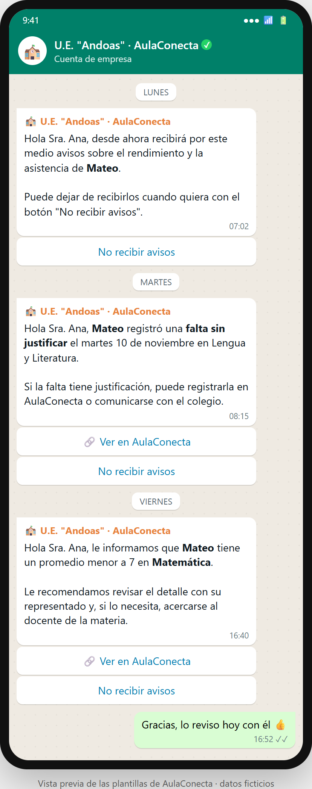

# Plantillas de mensajes de WhatsApp (v1)

AulaConecta envía **solo tres mensajes** por WhatsApp. WhatsApp Cloud API únicamente permite iniciar una conversación con **plantillas aprobadas por Meta**; las variables van como `{{1}}`, `{{2}}`… y ms-notificaciones las llena con los datos del evento. Categoría: **Utilidad** (avisos del servicio, no publicidad). Idioma: español.

| Código | Cuándo se envía | Requisito |
|---|---|---|
| `confirmacion_autorizacion` | Al registrar la autorización del representante | RF-29, RNF-05 |
| `promedio_bajo` | Cuando el promedio del estudiante en una materia baja de 7 | RF-30 |
| `falta_sin_justificar` | Cuando se registra una falta sin justificar | RF-31 |

Los atrasos, los avisos de tareas próximas y los comunicados (parte de RF-31 y RF-32) **no se envían por WhatsApp**: se ven en AulaConecta.

## Reglas de contenido (taller de riesgos y RNF-05)

- **Sin notas exactas ni datos de otros estudiantes:** el mensaje dice *qué pasó* y remite a AulaConecta para el detalle. Si el número es equivocado, el daño es mínimo (riesgo R6).
- Solo se envía a contactos con autorización registrada.
- Las tres plantillas tienen el botón **"No recibir avisos"** para darse de baja.
- Mismo motivo, mismo estudiante y mismo periodo → un solo mensaje (antiduplicados, RF-34).

## 1. `confirmacion_autorizacion`

```
🏫 U.E. "Andoas" · AulaConecta

Hola {{1}}, desde ahora recibirá por este medio avisos sobre el rendimiento y la asistencia de {{2}}.

Puede dejar de recibirlos cuando quiera con el botón "No recibir avisos".
```
Botón: `No recibir avisos` (respuesta rápida)
Variables: {{1}} = nombre del representante · {{2}} = nombre del estudiante

## 2. `promedio_bajo`

```
🏫 U.E. "Andoas" · AulaConecta

Hola {{1}}, le informamos que {{2}} tiene un promedio menor a 7 en *{{3}}*.

Le recomendamos revisar el detalle con su representado y, si lo necesita, acercarse al docente de la materia.
```
Botones: `Ver en AulaConecta` (enlace) · `No recibir avisos` (respuesta rápida)
Variables: {{1}} = representante · {{2}} = estudiante · {{3}} = materia

## 3. `falta_sin_justificar`

```
🏫 U.E. "Andoas" · AulaConecta

Hola {{1}}, {{2}} registró una *falta sin justificar* el {{3}} en {{4}}.

Si la falta tiene justificación, puede registrarla en AulaConecta o comunicarse con el colegio.
```
Botones: `Ver en AulaConecta` (enlace) · `No recibir avisos` (respuesta rápida)
Variables: {{1}} = representante · {{2}} = estudiante · {{3}} = fecha · {{4}} = materia

## Vista previa


