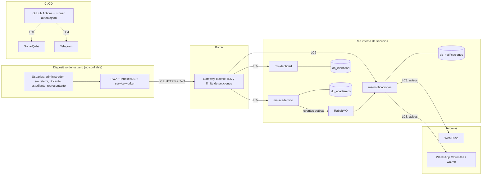

# Modelo de amenazas (STRIDE)

**Tarea:** T1023-A · **Responsable:** Abner David Arboleda Roman · **Fecha:** 26/10/2026 (planificada el 23/10) · **Sprint 3**

Este modelo parte del [taller de vulnerabilidades y riesgos](../analisis) (V1 a V5 y la política mínima de seguridad), de la arquitectura v2 ([C4](../arquitectura/Diagramas/c4_contexto_contenedores.md), [trabajo sin conexión](../arquitectura/Diagramas/trabajo_sin_conexion.md), [modelo de datos](../arquitectura/modelo_datos.md)) y de los requisitos RNF-04, RNF-05 y RNF-09 del SRS. Los datos que se protegen y su clasificación están en [datos_sensibles.md](datos_sensibles.md).

## 1. Método

1. Se dibuja el flujo de datos con sus **límites de confianza** (sección 2).
2. Para cada componente y flujo se buscan amenazas de las seis categorías **STRIDE**: suplantación (S), manipulación (T), repudio (R), divulgación de información (I), denegación de servicio (D) y elevación de privilegios (E).
3. Cada amenaza se califica con la misma escala del taller: impacto y probabilidad (Alto, Medio, Bajo) dan el **nivel de riesgo**.
4. Cada control se enlaza con la tarea del cronograma ([Planificacion_v2.xlsx](../planificacion/Planificacion_v2.xlsx)) que lo implementa, para seguirlo en el Product Backlog.

## 2. Flujo de datos y límites de confianza

| Límite | Entre | Qué cruza |
|---|---|---|
| LC1 | Dispositivo ↔ gateway | Credenciales, JWT, notas, asistencia, planificaciones, cambios sin conexión |
| LC2 | Gateway ↔ servicios | Peticiones ya filtradas por TLS y por límite de peticiones; cada servicio valida el JWT |
| LC3 | ms-notificaciones ↔ terceros | Número del representante y texto del aviso |
| LC4 | Repositorio ↔ CI/CD | Código, secretos del pipeline y resultados de los análisis |

## 3. Amenazas

Nivel: **A** = alto · **M** = medio · **B** = bajo.

### Suplantación (S)

| ID | Dónde | Amenaza | Nivel | Controles | Tarea |
|---|---|---|---|---|---|
| S-01 | ms-identidad | Alguien entra con la clave inicial, que es la cédula (RF-03) y la conocen otras personas | A | Cambio obligatorio en el primer ingreso, bloqueo tras 3 intentos fallidos, hash Argon2/BCrypt | T1105-A, T1106-A |
| S-02 | LC1, LC2 | Un JWT robado o falsificado se usa para llamar a la API | A | JWT RS256 con expiración corta; cada servicio lo valida con JWKS; cierre por inactividad en la PWA | T1105-A, T1105-M, T1106-M, T1106-C |
| S-03 | LC2 | Un servicio interno es suplantado para pedir datos a otro | M | Token de servicio (client credentials) entre ms-academico y ms-identidad; servicios solo en la red interna de Docker | T1110-A |
| S-04 | ms-notificaciones | Se falsifica el webhook de estado de WhatsApp para alterar el historial | M | Verificar la firma del webhook; registrar el evento antes de procesarlo | T1228-M |

### Manipulación (T)

| ID | Dónde | Amenaza | Nivel | Controles | Tarea |
|---|---|---|---|---|---|
| T-01 | ms-academico | Un estudiante cambia una nota enviando la petición directamente a la API | A | Autorización en el servicio dueño (solo el docente de la materia califica), DTO con lista blanca de campos | T1118-M, T1120-A |
| T-02 | ms-academico | Un usuario interno cambia notas sin dejar rastro (**V4**) | M | Auditoría con valor anterior, nuevo, usuario y fecha; bloqueo al cerrar el trimestre | T1126-M, T1126-A |
| T-03 | Sincronización | Un cambio hecho sin conexión sobrescribe el de otra persona (**V2**) | A | `baseVersion` y respuesta 409, bandeja de conflictos, clave de idempotencia por operación | T1231-M, T0104-M, T0104-A |
| T-04 | Importación Excel | Un archivo con fórmulas o demasiado grande daña los datos o el servidor | M | Validar tipo, tamaño y número de filas; validar cada fila; exportar sin fórmulas ejecutables | T1112-A, T1203-A |
| T-05 | Planificación | Código malicioso (XSS) en los campos de texto largo | M | Sanitizar al guardar y al mostrar; cabeceras CSP en la PWA | T1210-A |
| T-06 | CI/CD (LC4) | Una dependencia o una acción de GitHub comprometida entra al código | M | npm audit, pip-audit, Dependency-Check y Trivy; acciones fijadas por versión; permisos mínimos del workflow | T1029-M, T1029-A, T1104-A |

### Repudio (R)

| ID | Dónde | Amenaza | Nivel | Controles | Tarea |
|---|---|---|---|---|---|
| R-01 | Notas y planificaciones | Un docente niega haber cambiado una nota, o el administrador niega haber aprobado una planificación | M | Auditoría de notas, de accesos y de aprobaciones (RNF-09) | T1106-A, T1126-M, T1215-A |
| R-02 | WhatsApp asistido | No se puede saber quién envió (o no envió) un aviso manual | M | Estado `ENVIADA_MANUAL` con el usuario que lo envió (CR-01) | T1228-M |

### Divulgación de información (I)

| ID | Dónde | Amenaza | Nivel | Controles | Tarea |
|---|---|---|---|---|---|
| I-01 | PWA (dispositivo) | Datos de menores legibles en un equipo compartido, perdido o robado (**V1**) | A | Cifrado AES-GCM con WebCrypto; borrado al cerrar sesión y tras 15 min de inactividad; el service worker no guarda respuestas sensibles | T1230-A, T0105-A |
| I-02 | ms-academico | Un estudiante o representante consulta datos de otro cambiando un identificador (IDOR) | A | Filtrar siempre por el `usuario_id` del token; pruebas 403 en cada módulo | T1111-A, T1120-A, T1207-A |
| I-03 | LC3 | El aviso llega a una persona equivocada (**V3**) | A | Número verificado con el mensaje de confirmación de autorización; plantillas sin detalle de notas | T1221-C, T1222-A, T1224-A |
| I-04 | Repositorio y CI | Datos reales o secretos publicados en el repositorio, los registros o Telegram | A | Datos ficticios, Gitleaks con reglas de cédula y celular, mensajes del CI sin datos personales | T1022-A, T1029-A |
| I-05 | Roles | La Secretaría ve calificaciones o planificaciones | M | Permisos denegados por defecto; cada endpoint declara los roles permitidos | T1105-M, T1111-A |
| I-06 | Pantallas y exportaciones | La cédula completa aparece en listados, reportes o archivos | M | Cédula enmascarada fuera de la ficha del estudiante | T1111-A |
| I-07 | LC1 | Tráfico interceptado en la red del colegio | M | TLS en el gateway; HSTS en la PWA | T1027-A |
| I-08 | Respaldos | Una copia de la base termina en manos de alguien sin permiso | M | Respaldos con acceso restringido y prueba de restauración documentada | T0113-M |

### Denegación de servicio (D)

| ID | Dónde | Amenaza | Nivel | Controles | Tarea |
|---|---|---|---|---|---|
| D-01 | Gateway | Inundación de peticiones al inicio de sesión o a las consultas (**V5**) | A | Límite de peticiones por IP y por usuario en Traefik; bloqueo temporal y registro del evento | T1027-A, T0107-A |
| D-02 | RabbitMQ y ms-notificaciones | Un mensaje defectuoso bloquea la cola de avisos | M | Reintentos con backoff y cola de mensajes fallidos (DLQ) | T1223-A |
| D-03 | WhatsApp Cloud API | Avisos repetidos que generan gasto innecesario | M | Clave antiduplicado por estudiante, materia, motivo y día; el nivel 3 de pago es opcional | T1224-C |

### Elevación de privilegios (E)

| ID | Dónde | Amenaza | Nivel | Controles | Tarea |
|---|---|---|---|---|---|
| E-01 | Servicios | Un usuario obtiene permisos de otro rol ocultando o cambiando opciones en la PWA | A | La autorización se decide en el servidor con los roles del JWT firmado; la PWA solo oculta opciones | T1105-M, T1109-A |
| E-02 | Bases de datos | Inyección SQL en filtros o búsquedas | M | Consultas parametrizadas (Prisma, JPA, SQLAlchemy); pruebas de inyección | T1109-A |
| E-03 | Runner autoalojado | Código de un pull request ejecuta comandos en la máquina del runner, que hoy corre con una cuenta de administrador de Windows | A | Ejecutar el servicio del runner con una cuenta sin privilegios; no usar `pull_request_target`; PR de forks con aprobación manual | T1030-A |

## 4. Controles por rol

La autorización se aplica en el servicio dueño del dato, nunca solo en la PWA.

| Rol | Puede | No puede | Control técnico |
|---|---|---|---|
| Administrador (vicerrector) | Configurar el año lectivo, cursos, docentes y parámetros; aprobar o devolver planificaciones; ver el tablero institucional y el historial de avisos | Cambiar notas a nombre de un docente sin dejar auditoría | Rol `ADMIN` en el JWT; auditoría de aprobaciones y de cambios de parámetros |
| Secretaría | Matricular, importar nóminas, registrar representantes, números de WhatsApp y autorizaciones; enviar avisos asistidos | Ver calificaciones, comportamiento o planificaciones | Rol `SECRETARIA`; endpoints académicos de notas y planificación le devuelven 403 |
| Docente | Planificar, calificar, tomar asistencia y registrar comportamiento **solo en sus materias y cursos asignados**; ver el historial de avisos de sus estudiantes | Calificar materias ajenas; editar una planificación en revisión; ver cursos que no dicta | Rol `DOCENTE` más la asignación docente–materia–paralelo verificada en cada petición |
| Estudiante | Ver sus notas, tareas, asistencia, horario y calendario | Ver datos de otro estudiante; modificar notas | Rol `ESTUDIANTE`; consultas filtradas por su `usuario_id` |
| Representante | Ver notas, asistencia y calendario **solo de sus representados**; recibir avisos y darse de baja | Ver otros estudiantes | Rol `REPRESENTANTE` más la relación `REPRESENTACION` verificada en cada petición |
| Cuentas de servicio | Llamadas entre microservicios | Actuar como un usuario | Token de servicio con permisos acotados (client credentials) |

## 5. Controles para los datos de menores

| Control | Qué hace | Amenazas |
|---|---|---|
| Minimización | Cada servicio guarda solo lo que necesita: los teléfonos viven solo en ms-notificaciones y ms-identidad no guarda datos académicos | I-02, I-05 |
| Consentimiento | Solo se avisa a números autorizados; el representante puede darse de baja (RNF-05) | I-03 |
| Mensajes mínimos | Las plantillas dicen el motivo (promedio bajo o falta) sin notas detalladas | I-03 |
| Cifrado y borrado local | Datos sin conexión cifrados y eliminados al salir | I-01 |
| Trazabilidad | Quién vio o cambió notas, planificaciones y avisos | T-02, R-01, R-02 |
| Datos ficticios fuera de producción | Repositorio, pruebas y demos sin datos reales | I-04 |
| Normativa | Tratamiento de datos de menores conforme a la Ley Orgánica de Protección de Datos Personales de Ecuador (RNF-04), con autorización del representante | I-03, I-04 |

## 6. Trazabilidad con el taller

| Vulnerabilidad del taller | Riesgo del taller | Amenazas de este modelo |
|---|---|---|
| V1. Datos sin cifrar en el equipo | Filtración de datos de menores (alto) | I-01 |
| V2. Sincronización sin regla de conflictos | Pérdida o alteración de notas (alto) | T-03 |
| V3. Número de WhatsApp sin verificar ni autorización | Aviso a una persona equivocada (alto) | I-03, D-03 |
| V4. Sin registro de cambios en las notas | Manipulación de calificaciones (medio) | T-02, R-01 |
| V5. Sin límite de peticiones | Caída del sistema por DDoS (alto) | D-01 |

Este modelo agrega amenazas que el taller no cubría porque aparecieron con la arquitectura de microservicios y el CI/CD: S-02, S-03, S-04, T-06, I-04, E-03.

## 7. Seguimiento

- **Riesgo que requiere acción ya:** E-03. El runner autoalojado ejecuta el pipeline con una cuenta de administrador de Windows (se ve en la ruta `C:\Users\Administrador\` del registro del CI). Conviene cambiar la cuenta del servicio antes de aceptar pull requests de forks.
- Cada amenaza se cierra cuando su tarea está terminada y tiene evidencia (prueba en el CI o captura).
- El modelo se revisa en el informe de seguridad del sprint 7 (T1218-A) y en el informe final (T0111-A), y se actualiza si cambia la arquitectura.
