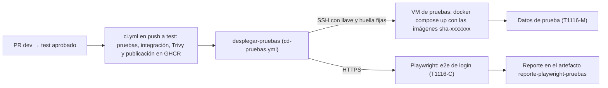

# Ambiente de pruebas con despliegue continuo (T1116-A)

Cada push a `test` despliega solo en una VM de pruebas, carga los datos ficticios y corre la prueba e2e de login contra ella.



| Pieza | Archivo |
|---|---|
| Job que despliega en cada push a `test` | `desplegar-pruebas` en [ci.yml](../../.github/workflows/ci.yml) |
| Despliegue y e2e (también se ejecuta a mano) | [cd-pruebas.yml](../../.github/workflows/cd-pruebas.yml) |
| Diferencias con el stack local: imágenes de GHCR, migraciones y datos de prueba | [docker-compose.pruebas.yml](docker-compose.pruebas.yml) |
| Lo que corre en el servidor en cada despliegue | [desplegar.sh](desplegar.sh) |
| Preparación de la VM, una sola vez | [preparar_servidor.sh](preparar_servidor.sh) |
| Configuración del GitHub Environment `pruebas` | [configurar_ambiente.sh](configurar_ambiente.sh) |

## Qué se despliega

Lo que se despliega es exactamente lo que el CI analizó:

- **Imágenes:** las 4 que el CI escaneó con Trivy y publicó en GHCR, con la etiqueta `sha-<commit>`. En el servidor no se compila nada.
- **Migraciones:**
  - ms-identidad aplica Flyway al arrancar y ms-notificaciones aplica Alembic al arrancar;
  - las de ms-academico corren en una imagen de un solo uso que solo tiene el lockfile y `prisma/`, porque la imagen del servicio no incluye la CLI de Prisma.
- **Datos de prueba** ([infra/datos-prueba](../datos-prueba/README.md)): se cargan en cada despliegue. Los scripts se pueden ejecutar varias veces: actualizan los registros por su id y no duplican.
- **Comprobación:** al terminar se revisan las 4 rutas de salud a través del gateway, desde el servidor y desde Internet.
- **Historial:** se conservan las 3 versiones más recientes en `/opt/aulaconecta/versiones/`.

## Puesta en marcha (una sola vez)

### 1. Claves y llave de despliegue

En tu equipo, con [GitHub CLI](https://cli.github.com) autenticado y permiso de administrador en el repositorio:

```bash
bash infra/despliegue/configurar_ambiente.sh claves
```

Esto hace lo siguiente:
- crea el Environment `pruebas`, que solo puede desplegar la rama `test`;
- genera las claves de PostgreSQL y RabbitMQ y la clave de las cuentas de prueba;
- genera una llave SSH ed25519. La llave privada se guarda en GitHub y la pública se imprime en pantalla.

Si el equipo ya acordó una clave para las cuentas de prueba, pásala así: `CLAVE_DATOS_PRUEBA=... bash ... claves`.

### 2. La VM

**Requisitos:** Ubuntu 24.04 x86-64 con al menos 4 GB de RAM, los puertos 22, 80 y 443 abiertos y un nombre DNS.

Con **Azure for Students** (crédito gratuito con el correo de la universidad):

```bash
az group create --name aulaconecta-pruebas --location eastus2
az vm create --resource-group aulaconecta-pruebas --name aulaconecta-pruebas \
  --image Ubuntu2404 --size Standard_B2s --admin-username administrador \
  --generate-ssh-keys --public-ip-sku Standard --public-ip-address-dns-name aulaconecta-pruebas
az vm open-port --resource-group aulaconecta-pruebas --name aulaconecta-pruebas --port 80,443 --priority 900
```

El nombre queda como `aulaconecta-pruebas.eastus2.cloudapp.azure.com`. Después, prepara la VM:

```bash
scp infra/despliegue/preparar_servidor.sh administrador@aulaconecta-pruebas.eastus2.cloudapp.azure.com:
ssh administrador@aulaconecta-pruebas.eastus2.cloudapp.azure.com \
  'sudo bash preparar_servidor.sh "<llave pública del paso 1>"'
```

### 3. Dirección del servidor

```bash
bash infra/despliegue/configurar_ambiente.sh servidor aulaconecta-pruebas.eastus2.cloudapp.azure.com
```

Esto guarda en el Environment la dirección, el usuario, las **huellas SSH** del servidor y la URL. Compara las huellas que imprime con las que mostró `preparar_servidor.sh`: GitHub Actions solo se conecta a un servidor con esas huellas.

### 4. Primer despliegue

Basta con unir el PR `dev → test`. Para desplegar sin esperar un push:
1. abre **Actions › CD pruebas › Run workflow**;
2. elige la rama `test`;
3. en «version» escribe una etiqueta ya publicada, por ejemplo `sha-1a2b3c4`, o déjala vacía.

## Qué guarda el Environment `pruebas`

| Tipo | Nombre | Para qué |
|---|---|---|
| Secreto | `SSH_CLAVE_PRIVADA` | Entrar al servidor como `despliegue` |
| Secreto | `POSTGRES_PASSWORD`, `POSTGRES_IDENTIDAD_PASSWORD`, `POSTGRES_ACADEMICO_PASSWORD`, `POSTGRES_NOTIFICACIONES_PASSWORD` | Bases del ambiente (ver la advertencia de abajo) |
| Secreto | `RABBITMQ_PASSWORD` | Bus de eventos |
| Secreto | `CLAVE_DATOS_PRUEBA` | Clave de las cuentas ficticias (`rosa.prueba`, `marta.ficticia`...) y de la prueba e2e |
| Variable | `SSH_HOST`, `SSH_USUARIO`, `SSH_HUELLAS`, `SSH_CLAVE_PUBLICA` | Conexión SSH verificada |
| Variable | `URL_PRUEBAS` | URL del ambiente, que aparece en el despliegue y en la pestaña Environments |

> **Advertencia:** las claves de PostgreSQL se aplican una sola vez, al crear el volumen de datos. Si cambian después, los servicios ya no entran a sus bases. Para cambiarlas hay que borrar los datos del ambiente: `docker compose -p aulaconecta down -v` en el servidor, y el siguiente despliegue vuelve a crearlos.

El workflow escribe estas claves en `/opt/aulaconecta/.env` (permisos 600) por la entrada estándar de SSH, así que no quedan en la línea de comandos ni en el log. Para descargar las imágenes privadas de GHCR usa el token temporal del propio job, de solo lectura, y cierra la sesión al terminar.

## Operación

| Necesito... | Cómo |
|---|---|
| Volver a una versión anterior | **Actions › CD pruebas › Run workflow** con la etiqueta `sha-xxxxxxx` de esa versión |
| Ver qué está desplegado | La pestaña **Environments › pruebas** del repositorio, o `cat /opt/aulaconecta/historial.txt` en el servidor |
| Ver los registros de un servicio | `ssh despliegue@<servidor>` y `docker compose -p aulaconecta logs -f ms-identidad` |
| Empezar con datos limpios | En el servidor: `docker compose -p aulaconecta down -v`. El siguiente despliegue recrea todo |

El certificado es autofirmado y lleva el nombre del servidor: el navegador muestra una advertencia la primera vez, y Playwright la ignora (`E2E_BASE_URL` activa `ignoreHTTPSErrors`).

## Prueba local del despliegue

`desplegar.sh` también corre en un equipo con Docker. Así se probó antes de tener la VM:
- con imágenes construidas en local (`OMITIR_DESCARGA=1` y `REGISTRO=aulaconecta-local`);
- con otro nombre de proyecto (`PROYECTO=aulaconecta-pruebas-local`), para no tocar el stack local.

```bash
# Imágenes con el mismo nombre que tendrían en GHCR
for s in ms-identidad ms-academico ms-notificaciones pwa; do docker tag aulaconecta-construccion-$s aulaconecta-local/$s:local; done
# Carpeta que imita el servidor: <dir>/.env y <dir>/versiones/local/{infra,services/ms-academico/...}
OMITIR_DESCARGA=1 REGISTRO=aulaconecta-local PROYECTO=aulaconecta-pruebas-local DIR_DESPLIEGUE=<dir> \
  bash infra/despliegue/desplegar.sh local
cd apps/pwa && E2E_BASE_URL=https://localhost E2E_CLAVE_PRUEBA=<clave> npx playwright test e2e/login.spec.ts
```
